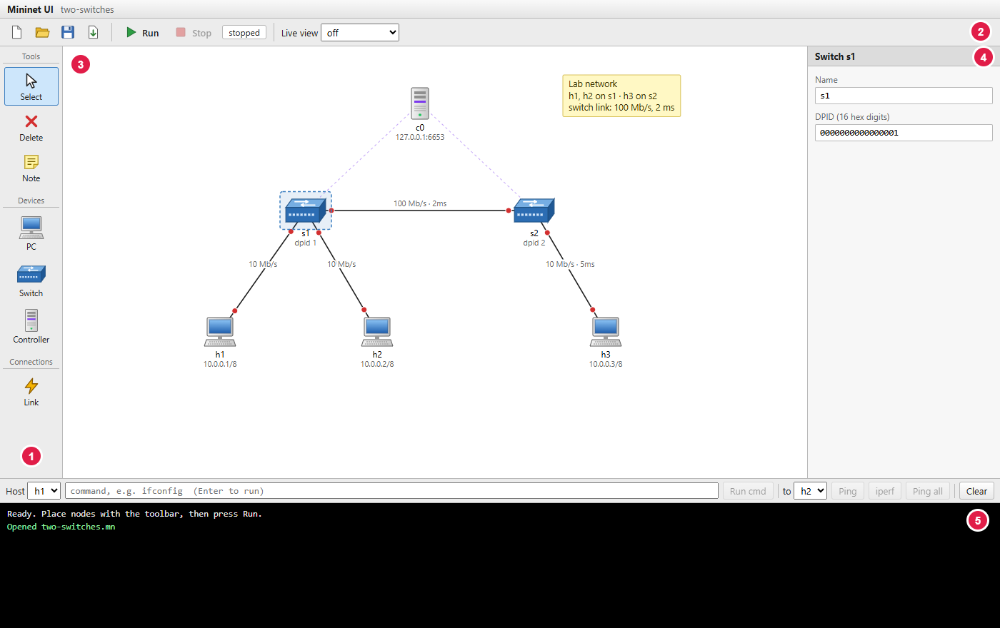
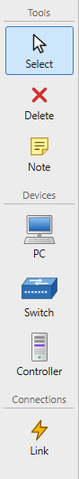
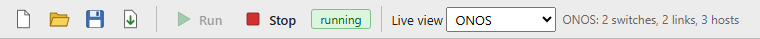
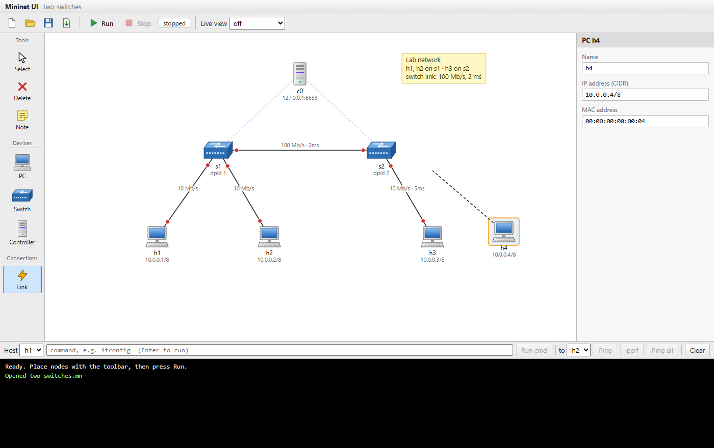
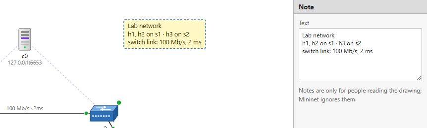
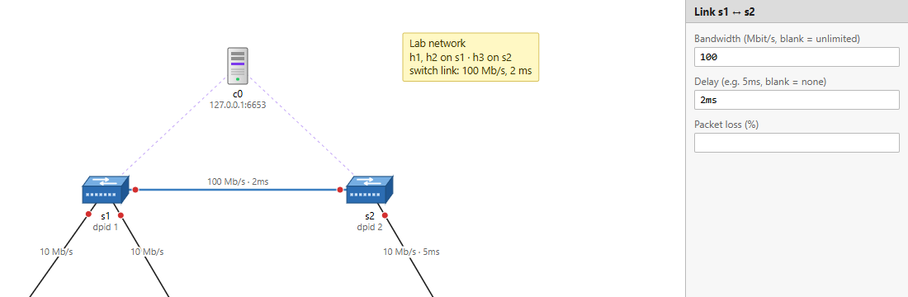
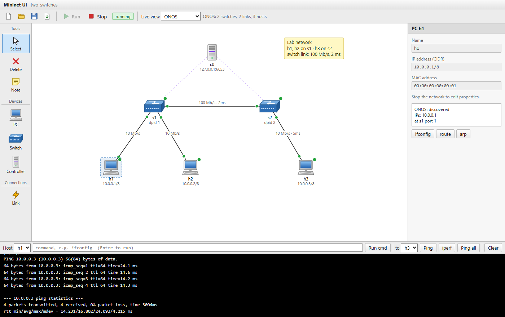
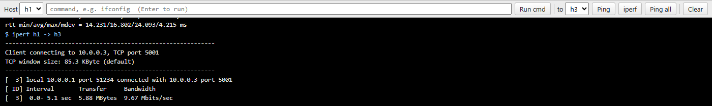
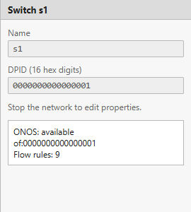

# Mininet UI

Build a computer network by drawing it, then run it for real, all in your web browser.

Mininet UI works like Cisco Packet Tracer: you drag PCs, switches and a
controller onto a workspace and connect them with links. The difference is
that when you press **Run**, the network actually starts on your computer
using [Mininet](http://mininet.org), and an SDN controller
(**ONOS** or **OpenDaylight**) takes charge of the switches. You can then
ping between PCs, measure speed, and watch what the controller sees.



---

## Contents

1. [What you need](#1-what-you-need)
2. [Install and start](#2-install-and-start)
3. [A tour of the screen](#3-a-tour-of-the-screen)
4. [Build your first network](#4-build-your-first-network)
5. [Change settings](#5-change-settings)
6. [Run the network and test it](#6-run-the-network-and-test-it)
7. [See what the controller sees (live view)](#7-see-what-the-controller-sees-live-view)
8. [Save, open and export](#8-save-open-and-export)
9. [Keyboard shortcuts](#9-keyboard-shortcuts)
10. [Something went wrong?](#10-something-went-wrong)
11. [For developers](#11-for-developers)

---

## 1. What you need

- An **Ubuntu 22.04** computer or virtual machine (VirtualBox is fine).
- An SDN controller, if you want the switches to forward traffic:
  - **ONOS**, for example in Docker (`docker run ... --name onos onosproject/onos:2.7.0`), or
  - **OpenDaylight**.

  You can draw and save networks without a controller. You only need one to
  run them.
- A web browser (Firefox comes with Ubuntu).

You do **not** need to install Mininet yourself. The start script does it.

## 2. Install and start

Open a **Terminal** (press `Ctrl` + `Alt` + `T`) and type these lines one at a time,
pressing `Enter` after each:

```bash
cd mininet-ui
chmod +x run.sh
./run.sh
```

- `cd mininet-ui` moves into the folder where you put this tool.
- `chmod +x run.sh` allows the start script to run. You only need this once.
- `./run.sh` starts everything.

The script will:

1. ask for your password (it needs administrator rights to create the network);
2. install anything that is missing (Mininet, Open vSwitch, Flask, iperf);
3. start ONOS if you have an `onos` Docker container that is stopped;
4. open **<http://localhost:8080>** in your browser.

Keep the terminal window open while you use the tool. To quit, go back to
the terminal and press `Ctrl` + `C`.

> **Tip:** Next time, you only need `cd mininet-ui` and `./run.sh`.
> Type `./run.sh --no-browser` if you don't want a browser window opened.

## 3. A tour of the screen

The numbers match the picture at the top of this page.

| # | Area | What it is for |
|---|------|----------------|
| 1 | **Device palette** (left) | Pick a tool or a device to place: PC, Switch, Controller, or a Link. |
| 2 | **Toolbar** (top) | New, Open, Save, Export, **Run** / **Stop**, and the **Live view** menu. |
| 3 | **Workspace** (middle) | Where you draw your network. |
| 4 | **Properties** (right) | Settings of whatever you clicked: name, IP address, link speed... |
| 5 | **Console** (bottom) | Run commands on PCs (ping, iperf, ...) and read their output. |

<table>
<tr>
<td valign="top"></td>
<td valign="top">

**Device palette**

| Button | What it does |
|--------|--------------|
| **Select** | Click things to see their settings; drag them to move them. |
| **Delete** | Click a device, link or note to remove it. |
| **Note** | Click the workspace to add a text note (see [Add notes](#add-notes)). |
| **PC** | A computer (a Mininet *host*). |
| **Switch** | An OpenFlow switch. It forwards traffic the way the controller tells it to. |
| **Controller** | The SDN controller (ONOS or OpenDaylight) that manages the switches. |
| **Link** | A cable. Click one device, then another, to connect them. |

</td>
</tr>
</table>

**Toolbar**



From left to right: **New** (empty workspace), **Open**, **Save**,
**Export** (download a Python script), **Run**, **Stop**, the network
status (*stopped* / *running*), and **Live view**.

## 4. Build your first network

Let's build two PCs connected through one switch.

1. Click **Controller** in the palette, then click near the top of the workspace.
2. Click **Switch**, then click in the middle of the workspace.
3. Click **PC**, then click twice below the switch to place two PCs.
4. Click **Link** (the lightning bolt). Click the first PC, then the switch.
   A dashed line follows your mouse until you click the second device.
5. Do the same for the second PC.
6. Click **Select** (or press `Esc`) when you're done.



Good to know:

- Every new device gets sensible settings automatically: PCs are named
  `h1`, `h2`... with addresses `10.0.0.1`, `10.0.0.2`...; switches are `s1`, `s2`...
- **You don't draw links to the controller.** Every switch is connected to every
  controller automatically, shown as thin dashed purple lines.
- The small dots at each end of a link are **port lights**, like in Packet Tracer:

  | Light | Meaning |
  |-------|---------|
  | 🔴 red | The network is not running. |
  | 🟢 green | The link is up. |
  | 🟠 amber | The network is running, but the controller hasn't discovered this link yet (live view only). |

- Your drawing is remembered by the browser, even if you close the tab. Still,
  **save it to a file** (see [section 8](#8-save-open-and-export)) to keep it safe.

Want a ready-made example? Click **Open** and choose
`examples/two-switches.mn`.

### Add notes

Notes are text labels on the workspace, for example to explain what part
of the network is for, or to write down an assignment question.

1. Click **Note** in the palette, then click where the note should go.
2. Type your text in the **Text** box on the right. Press `Enter` for a new line.
3. Drag the note to move it. Double-click it to edit the text again.
   Select it and press `Delete` to remove it.



Notes are saved with your file. They don't change the network, so you can
add or edit them even while it is running. In an exported Python script
they appear as comments (`# Note: ...`).

## 5. Change settings

Click a device or a link (with **Select**) and edit its settings in the
**Properties** panel on the right. Changes apply immediately.



| Item | Setting | Example | Notes |
|------|---------|---------|-------|
| PC | Name | `h1` | Letters and digits, up to 8, starting with a letter. |
| PC | IP address | `10.0.0.1/8` | `/8` is added if you leave it out. |
| PC | MAC address | `00:00:00:00:00:01` | Must be different for every PC. |
| Switch | DPID | `0000000000000001` | The switch's ID, as the controller shows it. |
| Controller | IP and port | `127.0.0.1`, `6653` | `127.0.0.1` means "this computer". |
| Link | Bandwidth | `10` | Speed limit in Mbit/s. Empty = no limit. |
| Link | Delay | `5ms` | Extra delay on the cable. Empty = none. |
| Link | Packet loss | `1` | Percentage of packets dropped. Empty = none. |

While the network is running, settings are locked (greyed out). Press
**Stop** to change them. You can still move devices around.

If something is wrong (for example two PCs with the same IP address), the
console tells you exactly what to fix when you press **Run** or **Export**.

## 6. Run the network and test it

1. Make sure your controller (ONOS or OpenDaylight) is running.
2. Press **Run**. After a few seconds the status turns to **running** and the
   port lights turn green.
3. Press **Ping all** in the console bar. Every PC tries to reach every other PC.
   `0% dropped` means everything can talk to everything.



In the console bar at the bottom:

- **Host**: the PC that runs the command. Clicking a PC on the workspace selects it here.
- **to**: the target PC for **Ping** and **iperf**.
- **Ping**: sends 4 pings from *Host* to *to*.
- **iperf**: measures the speed between the two PCs for 5 seconds.
- **Ping all**: ping between every pair of PCs.
- **Command box**: type any Linux command to run on the selected PC, for
  example `ifconfig`, `ip route` or `ping -c 2 10.0.0.3`, and press `Enter`.
  Commands are stopped after 30 seconds.
- **Clear**: empties the console.

When a PC is selected while the network runs, the Properties panel also has
quick buttons: **ifconfig**, **route**, **arp**.



Press **Stop** when you're done. The whole network is removed cleanly.

## 7. See what the controller sees (live view)

Choose **ONOS** or **OpenDaylight** in the **Live view** menu on the toolbar.
Every 3 seconds the tool asks the controller what it knows and colours the workspace:

| You see | It means |
|---------|----------|
| 🟢 dot on a switch | The switch is connected to the controller. |
| 🔴 dot on a switch | The controller doesn't know this switch. |
| 🟢 dot on a PC | The controller has seen this PC on the network. |
| 🟢 / 🟠 port lights | The controller has / hasn't discovered this link. |

Next to the menu you'll see a summary such as *ONOS: 2 switches, 2 links, 3 hosts*.

Click a switch to see its controller ID and how many **flow rules** (forwarding
instructions) the controller has installed in it:



> **Why are my PCs not green?** Controllers only notice a PC once it sends
> traffic. Press **Ping all** once. Newer OpenDaylight versions don't track
> PCs at all; in that case PCs simply stay uncoloured.

## 8. Save, open and export

| Button | What it does |
|--------|--------------|
| **Save** | Asks for a file name and downloads your network. The default is a **`.mn`** file. |
| **Open** | Loads a `.mn` or `.json` file. |
| **Export** | Downloads a **Python script** that builds the same network without this tool. |

- **`.mn` files** use the same format as **MiniEdit** (the editor that comes
  with Mininet). You can open your files in MiniEdit, and open old MiniEdit
  files here. Settings this tool doesn't use (such as MiniEdit's built-in
  controllers or legacy switches) are converted, and the console tells you what changed.
- Type a name ending in **`.json`** in the Save box to save in this tool's own format instead.
- To run an exported script yourself: `sudo python3 my-network.py`. It opens
  the Mininet command line (`mininet>`); type `exit` to stop it.

Downloaded files go to your **Downloads** folder.

## 9. Keyboard shortcuts

| Key | Action |
|-----|--------|
| `Esc` | Back to **Select**; cancels a link you started drawing. |
| `Delete` or `Backspace` | Delete the selected device, link or note. |
| Double-click a note | Edit its text. |
| `Enter` (in the command box) | Run the command. |

## 10. Something went wrong?

**The browser didn't open.**
Open Firefox yourself and go to `http://localhost:8080`.

**"Run" is greyed out.**
The tool was started without administrator rights. Close it (`Ctrl` + `C`
in the terminal) and start it again with `./run.sh`.

**Switches stay red / "Some switches did not connect to the controller".**
The controller isn't running or isn't reachable.
- ONOS: check it's running with `docker ps`. After starting, it needs about a
  minute. The `org.onosproject.openflow` app must be active.
- OpenDaylight: install the OpenFlow plugin in its console:
  `feature:install odl-openflowplugin-flow-services-rest`.
- The controller's IP and port in Properties should be `127.0.0.1` and `6653`.

**Ping all shows `X` / 100% dropped.**
The switches are connected but nobody tells them how to forward traffic.
- ONOS: activate the forwarding app `org.onosproject.fwd`.
- OpenDaylight: older releases need the `odl-l2switch-switch-ui` feature;
  newer releases have no forwarding app, so you need to add flows yourself.

**Live view says "unreachable".**
The controller's web interface isn't answering on port 8181. ONOS and
OpenDaylight both use 8181, so run only one of them at a time.

**"Network is already running" or strange errors after a crash.**
Press **Stop**. If that doesn't help, quit the tool, run `sudo mn -c` in a
terminal, and start it again.

**The terminal says `$'\r': command not found`.**
The files were copied from Windows with the wrong line endings. Run
`sed -i 's/\r$//' run.sh` and try again.

---

## 11. For developers

### How it works

```
browser (frontend/)               backend/ (Python + Flask, runs as root)
  state.js   topology model    ──JSON──▶ app.py          HTTP API
  mnfile.js  .mn (MiniEdit) files         topology.py     validate + export script
  canvas.js  SVG workspace                runner.py       Mininet API (start/stop/cmd)
  ui.js      panels, console              controllers.py  ONOS / ODL REST ──▶ :8181
```

- The topology is a JSON object with `nodes` and `links` (format documented in
  [backend/topology.py](backend/topology.py)). The same object is saved, run and exported.
- `topology.normalize()` validates everything (names, unique IP/MAC/DPID, link
  values) and produces one "spec" used by both the script exporter and
  `runner.py`, so **Export** and **Run** build exactly the same network.
- `runner.py` uses the Mininet Python API directly. A lock serialises access,
  because each Mininet host is a single shell.
- `controllers.py` reads the controller's REST API on the server side (so the
  browser never needs the password and there are no CORS issues) and converts
  ONOS and OpenDaylight data into one format keyed by DPID. For OpenDaylight it
  tries the RFC 8040 paths (`/rests/data/...`) first and falls back to the old
  `/restconf/operational/...` ones.
- `mnfile.js` converts to and from MiniEdit's `.mn` format in the browser.
- Device icons are SVG `<symbol>`s at the top of
  [frontend/index.html](frontend/index.html), shared by the palette and the workspace.

### Manual start

```bash
sudo apt install python3-flask mininet openvswitch-switch iperf
sudo python3 backend/app.py         # then open http://localhost:8080
```

Without `sudo` the editor and **Export** still work; **Run** is disabled.

### Settings (environment variables)

Pass them like `PORT=9000 ./run.sh` (`run.sh` forwards them through `sudo`).

| Variable    | Default |
|-------------|---------|
| `PORT`      | `8080` |
| `HOST`      | `127.0.0.1`. Keep it: the server runs commands as root. |
| `ONOS_URL`  | `http://localhost:8181/onos/v1` |
| `ONOS_USER` / `ONOS_PASS` | `onos` / `rocks` |
| `ODL_URL`   | `http://localhost:8181` |
| `ODL_USER` / `ODL_PASS` | `admin` / `admin` |

### API

| Method | Path            | Body                 | Result |
|--------|-----------------|----------------------|--------|
| GET    | `/api/status`   |                      | `{root, running, hosts, switches}` |
| POST   | `/api/validate` | topology             | `{warnings}` or `{error, errors}` |
| POST   | `/api/export`   | topology             | `{script}` |
| POST   | `/api/start`    | topology             | `{warnings, hosts, switches}` |
| POST   | `/api/stop`     |                      | `{ok}` |
| POST   | `/api/cmd`      | `{node, cmd}`        | `{output}` |
| POST   | `/api/ping`     | `{src, dst}`         | `{output}` |
| POST   | `/api/iperf`    | `{src, dst}`         | `{output}` |
| POST   | `/api/pingall`  |                      | `{output}` |
| GET    | `/api/live?controller=onos\|odl` |    | `{ok, label, devices, links, hosts, flows}` |

### Tests

```bash
python3 -m unittest discover tests     # no root, Mininet or controller needed
```
